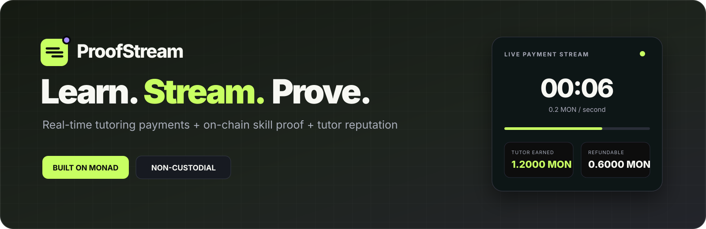

# ProofStream

**Real-time tutoring payments + on-chain skill proofs + portable tutor reputation on Monad.**

Students escrow native MON and pay tutors only for elapsed lesson time. Settlement pays the tutor, refunds the unused balance, and opens mutual attestation for an on-chain skill proof and tutor reputation.

## Highlights

- Non-custodial MON escrow and pro-rata payment streaming
- Live timer, tutor earnings, and refundable student balance
- Course video available only while the stream is funded
- Instant settlement, skill proof, and portable tutor reputation
- MIT course catalog and wallet-based session marketplace
- Mobile-friendly Next.js app plus a standalone Go Live demo

```text
Open → Funded → Active → Settled → Skill proof
```

All real payment, timing, refund, proof, and reputation logic lives in [`contracts/ProofStream.sol`](./contracts/ProofStream.sol). StudyToken plans are presentation-only; real settlement remains native MON.

## Stack

- Next.js 15 App Router, TypeScript, Tailwind CSS
- wagmi, viem, RainbowKit
- Solidity 0.8.28, Hardhat, OpenZeppelin `ReentrancyGuard`
- Monad Testnet — chain ID `10143`

## Run locally

Requirements: Node.js 20+, pnpm 11+, and browser wallets for tutor and student.

```bash
pnpm install
cp .env.example .env.local
pnpm dev
```

Open [http://localhost:3000](http://localhost:3000).

For the dependency-free visual demo, open [`index.html`](./index.html) with the VS Code **Live Server** extension.

## Compile and test

```bash
pnpm contract:compile
pnpm contract:test
pnpm typecheck
pnpm build
```

## Deploy to Monad Testnet

Create a root `.env` file:

```dotenv
PRIVATE_KEY=0xYOUR_TESTNET_ONLY_DEPLOYER_KEY
MONAD_RPC_URL=https://testnet-rpc.monad.xyz
```

Never commit this key. Fund the deployer with testnet MON from the [Monad faucet](https://faucet.monad.xyz), then run:

```bash
pnpm contract:deploy
```

Copy the returned contract address into `.env.local`:

```dotenv
NEXT_PUBLIC_CONTRACT_ADDRESS=0xDEPLOYED_CONTRACT
NEXT_PUBLIC_WALLETCONNECT_PROJECT_ID=YOUR_REOWN_PROJECT_ID
NEXT_PUBLIC_MONAD_RPC_URL=https://testnet-rpc.monad.xyz
```

Never commit private keys or local `.env` files.

> Monad Blitz hackathon MVP. The contract has not been professionally audited.
